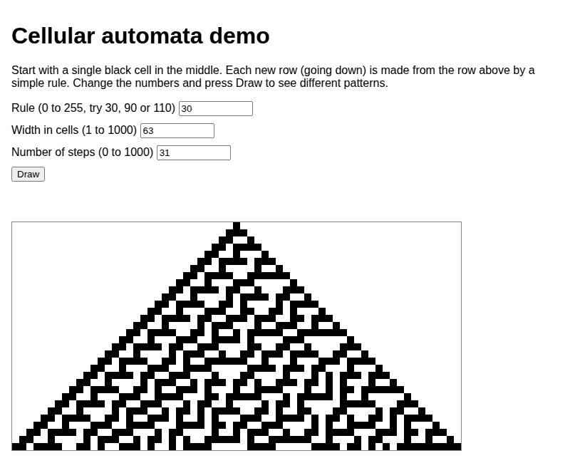

# cellular-automata-lab

Experiments with cellular automata, developed mostly by AI agents driven from GitHub issues.

```ts
import { run } from "cellular-automata-lab";

const start = [...Array(15).fill(0), 1, ...Array(15).fill(0)];
for (const row of run(start, 90, 8)) {
  console.log(row.map((c) => (c ? "#" : ".")).join(""));
}
```

## Web demo

The demo draws a pattern row by row (about 50 ms per row). This capture of the whole page (title, text, input form and canvas) shows how to use it: it presses Draw, then types rule 90 and rule 110 into the Rule field and presses Draw again each time to show the new pattern.



A small demo runs on your own computer (Node 22.12+):

```sh
npm ci
npm start
```

Then open http://localhost:8787 (`npm start -- --port 3000` uses another port). Pick a rule,
width and number of steps, and press Draw.

Browser tests (`tests/browser/`, Playwright) open the page of a server that is already running.
With `npm start` running in another terminal:

```sh
npx playwright install chromium   # once
npm run test:browser              # set BASE_URL to test another address
```

The page is static: the browser computes the pattern (`src/pattern.ts`) and there is no backend.
`npm run build:site` compiles the two modules to `web/elementary.js` and `web/pattern.js`; `web/`
can then be deployed to any static host. `npm start` runs that build and serves `web/` locally with
wrangler, the same way Cloudflare serves it (needs no Cloudflare account).

## Cloudflare deployment

The demo can be deployed to Cloudflare, which serves `web/` as static assets (`wrangler.jsonc`).
`npm run cf:deploy` publishes only these static assets; there is no Worker or server code.
It runs `npm run build:site` first.

```sh
npm ci
npm run cf:deploy   # deploy; run `npx wrangler login` first, or set CLOUDFLARE_API_TOKEN
```

On GitHub, a human deploys with the **Deploy** workflow (`.github/workflows/deploy.yml`, Actions →
Deploy → Run workflow); it never runs on its own. Pick the branch under "Use workflow from".
The run uses the GitHub environment `production`, or the one named by the repository variable
`DEPLOY_ENVIRONMENT` if set (Settings → Secrets and variables → Actions → Variables); create that
environment under Settings → Environments and give it two secrets:

- `CLOUDFLARE_API_TOKEN` – an API token made from the "Edit Cloudflare Workers" template
- `CLOUDFLARE_ACCOUNT_ID` – shown on the Workers & Pages overview in the Cloudflare dashboard

See [docs/ai-workflow.md](docs/ai-workflow.md) for how issues become pull requests.
