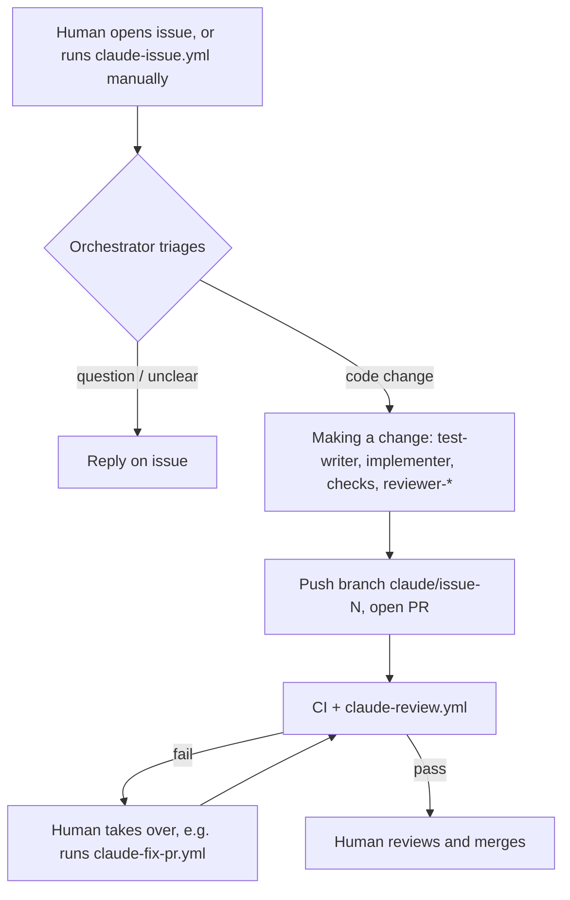

# AI-driven development workflow

How agents work – workflows, subagents, the order of steps and retry limits – is defined once in
[CLAUDE.md](../CLAUDE.md) ("AI-driven workflow"), which the agents themselves follow. This page
only adds an overview and what a human needs to set up.

If an agent run itself fails (API error, timeout), the workflow comments with a link to the run log.

## One-time setup
1. **Claude credentials** – one repository secret (Settings → Secrets and variables → Actions):
   - Claude Pro/Max subscription: run `claude setup-token` locally and store the output as
     `CLAUDE_CODE_OAUTH_TOKEN`. Usage counts against your subscription's limits.
   - Or pay-as-you-go API: create a key at console.anthropic.com and store it as `ANTHROPIC_API_KEY`.
   Both workflows accept either secret; set only one.
2. **GitHub App** – the agent acts as its own app, so PRs, comments and commits show up as
   `<app>[bot]` instead of as you. Pushes made with an app token also trigger CI and the review
   (pushes made with the default `GITHUB_TOKEN` would not).
   1. Create an app at <https://github.com/settings/apps/new>: any name, your repo URL as homepage,
      webhook *Active* unchecked, "Only on this account". Repository permissions: *Contents*,
      *Issues*, *Pull requests*: read & write; *Actions*: read.
   2. On the app's *General* page, note the **App ID** and click *Generate a private key*
      (downloads a `.pem` file).
   3. *Install App* → this repository only.
   4. Add repository secrets `APP_ID` (the number) and `APP_PRIVATE_KEY` (the whole `.pem` file).
3. Settings → Actions → General → Workflow permissions: allow GitHub Actions to create pull requests.
4. Recommended: protect `main` (require PR + passing CI) so nothing merges without a human.

## Safety
- Only issues from the owner, members, or collaborators start the agent; anyone else's issue is ignored.
  Manual runs can only be started by people with write access.
- The agent can only use the tools listed in `--allowedTools` and never merges PRs.
