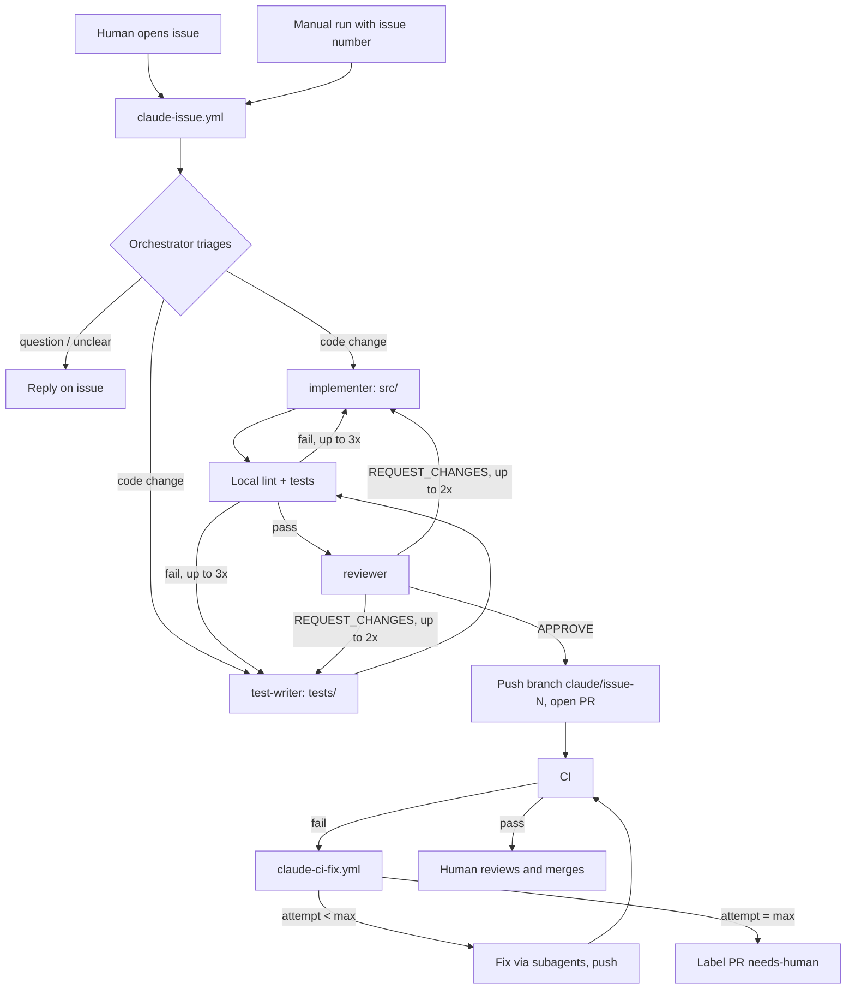

# AI-driven development workflow

## Files
| File | Role |
|---|---|
| `.github/workflows/claude-issue.yml` | Runs on new issues, or manually (Actions → *Claude – handle issue* → enter issue number). |
| `.github/workflows/ci.yml` | Lint (biome), typecheck (tsc) and tests (vitest) on Node 22, 24 and 26. |
| `.github/workflows/claude-ci-fix.yml` | When CI fails on a `claude/*` branch, the agent reads the log and pushes a fix. |
| `.claude/agents/implementer.md` | Subagent: edits production code only. |
| `.claude/agents/test-writer.md` | Subagent: edits tests only. |
| `.claude/agents/reviewer.md` | Subagent: read-only review, returns APPROVE / REQUEST_CHANGES. |
| `CLAUDE.md` | Project rules every agent reads. |

## Retries
- **Inside a run:** failing local checks go back to the responsible subagent (3 rounds); blocking review findings go back too (2 rounds).
- **Agent crash** (API error, timeout of the action): the issue workflow retries the agent once, then comments on the issue with the log link.
- **CI failure after push:** `claude-ci-fix.yml` tries up to 3 times (change with repository variable `CLAUDE_MAX_CI_FIX_ATTEMPTS`). Attempts are counted from marker comments on the PR. After the limit the PR gets the `needs-human` label.

## One-time setup
1. **Claude credentials** – one repository secret (Settings → Secrets and variables → Actions):
   - Claude Pro/Max subscription: run `claude setup-token` locally and store the output as
     `CLAUDE_CODE_OAUTH_TOKEN`. Usage counts against your subscription's limits.
   - Or pay-as-you-go API: create a key at console.anthropic.com and store it as `ANTHROPIC_API_KEY`.
   Both workflows accept either secret; set only one.
2. **GitHub App** – the agent acts as its own app, so PRs, comments and commits show up as
   `<app>[bot]` instead of as you. Pushes made with an app token also trigger CI and the fix loop
   (pushes made with the default `GITHUB_TOKEN` would not).
   1. Create an app at <https://github.com/settings/apps/new>: any name, your repo URL as homepage,
      webhook *Active* unchecked, "Only on this account". Repository permissions: *Contents*,
      *Issues*, *Pull requests*: read & write; *Actions*: read.
   2. On the app's *General* page, note the **App ID** and click *Generate a private key*
      (downloads a `.pem` file).
   3. *Install App* → this repository only.
   4. Add repository secrets `APP_ID` (the number) and `APP_PRIVATE_KEY` (the whole `.pem` file).
3. Settings → Actions → General → Workflow permissions: allow GitHub Actions to create pull requests.
4. Recommended: protect `main` (require PR + passing CI) so nothing merges without a human.

## Safety
- Only issues from the owner, members, or collaborators start the agent; anyone else's issue is ignored.
  Manual runs can only be started by people with write access.
- The CI-fix workflow only acts on `claude/*` branches in this repository, never on forks.
- The agent can only use the tools listed in `--allowedTools` and never merges PRs.
